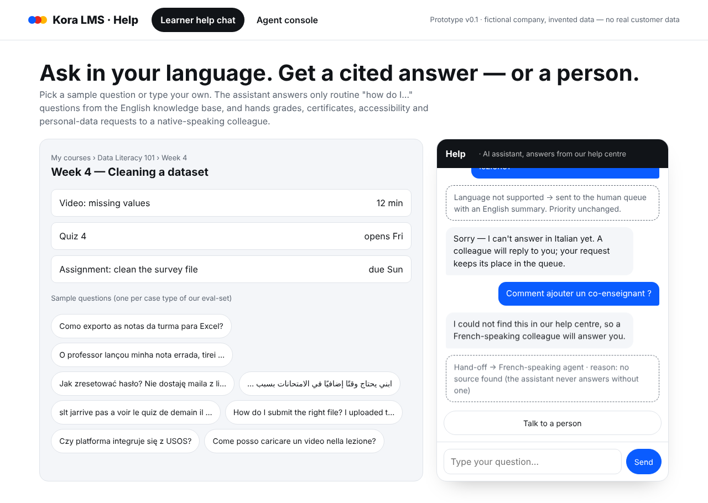
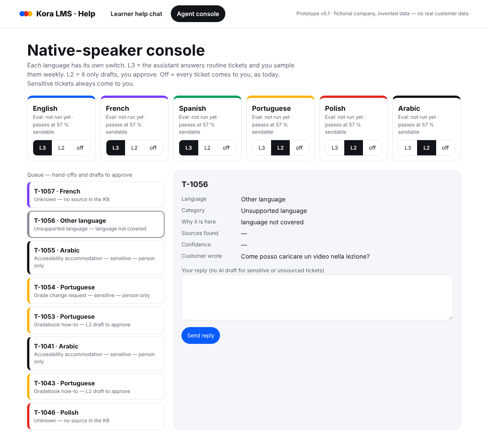

# 03 — Prototype link · P5 Multilingual LMS support agent

> One clickable prototype of where your agent lives (the surface), made in under an hour, before Session 4.
> It is a question for users, not the product: fake data is fine; real customer data is not.

- **Link:** https://claude.ai/artifact/WWtxfh3VN1eCaN1JjgtK3f (source in the repo: `docs/prototype/index.html` — opens in any browser)
- **Tool:** Claude artifact
- **Version:** v0.1 → v0.2 → v0.3 (what changed between versions, one line each): v0.1 — learner help chat (6 languages, cited answer, hand-off, "talk to a person") + native-speaker console (per-language switch L3 / L2 / off, queue, hand-off note, approve / edit / reject a draft); fictional company "Kora LMS", invented data · v0.2 — … (after the usability tests) · v0.3 — …
- **The prompt we used (the brief in three paragraphs):**

```
Paragraph 1 — who uses it and for what job:
A clickable prototype for the support of an ed-tech LMS used by universities and corporate academies in 14 countries.
Two users: (1) a learner, instructor or admin who asks a routine "how do I…" question in their own language
(English, French, Spanish, Portuguese, Polish, Arabic) and wants a correct answer without waiting;
(2) a native-speaking support agent who receives the tickets the AI must not answer and approves the AI drafts
in the languages that are not yet trusted. Fictional company, invented data, no real customer data.

Paragraph 2 — what is on the screen (panels, buttons, the one thing it must never do):
View 1 "Learner help chat": an LMS course page with a help chat on the right; sample questions in the 6 languages;
each AI answer carries an "AI answer" label, the answer in the user's language and the English source article it
comes from; a "talk to a person" button is always visible; Arabic is displayed right-to-left.
View 2 "Agent console": one card per language with a switch L3 / L2 / off; a queue of hand-offs and drafts;
a detail panel with the hand-off note (language, category, reason, sources found, confidence, what the customer wrote)
and buttons "approve and send", "sent with edits", "reject draft".
It must never answer a question about grades, assessments, certificates, accessibility or personal data.

Paragraph 3 — the rules (routing, what is “human only”, the trust level):
Sensitive requests (grade change or explanation, certificate, accessibility accommodation, data access or deletion)
→ short acknowledgement in the user's language and hand-off to a native-speaking agent: human only, no AI draft.
No source found in the knowledge base → no answer, hand-off. Language not among the 6 → hand-off, priority unchanged.
Trust level per language: English, French, Spanish start at L3 (the AI answers, a person samples);
Portuguese, Polish, Arabic start at L2 (the AI drafts, the native speaker approves before anything is sent);
the agent can switch any language to L3, L2 or off in the console, and the chat follows the switch.
```

- **Screenshot:**  · 
